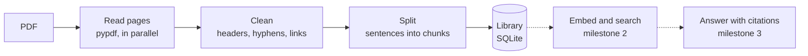

# PDF Q&A

[](https://github.com/omdkpatel810-ops/pdf-qa-rag/actions/workflows/tests.yml)


[](LICENSE)

Ask questions about your PDFs and get answers with page citations, using retrieval-augmented generation (RAG).

> **Status: milestone 1 of 4 is done.** PDFs are read, cleaned and split into chunks that remember their pages. Search and answers come next ([roadmap](#roadmap)).

**At a glance**

- Reads the **1,239-page** University of Manitoba undergraduate calendar into 9,350 chunks in **86 s**. That's half the 162 s a single process takes, because pages are read in parallel, one process per core (this machine has 2).
- Repairs words hyphenated at line ends using the document itself as the dictionary. It is right on **342 of 346** in two well-known papers, and keeps 47 real compounds like *fine-tuned* that the usual "always join" rule mangles into *finetuned*.
- 152 tests with 100% line coverage. They include property-based tests (Hypothesis) that check, on 300 random documents per run, that every word lands in a chunk, in order, within the size limit.

## How it works



1. **Read.** Every page's text, its printed page number (so citations can say "p. iv") and the title from the PDF's metadata. Long PDFs are read by several processes at once.
2. **Clean.** PDFs store lines, not paragraphs, so the text needs repair before it's useful (see [What cleaning fixes](#what-cleaning-fixes)).
3. **Split.** Pages become chunks of up to 200 words built from whole sentences. Each chunk repeats the end of the one before, and records the pages it came from.
4. **Store.** Documents, cleaned pages and chunks go into one SQLite file. Re-splitting with other settings works from the stored pages, without the PDF.

## Quick start

Requires Python 3.10 or newer.

```bash
git clone https://github.com/omdkpatel810-ops/pdf-qa-rag.git
cd pdf-qa-rag
python3 -m venv .venv
source .venv/bin/activate        # Windows: .venv\Scripts\activate
pip install -e ".[dev]"

python scripts/get_samples.py    # two papers and a UofM calendar section, into samples/
pdfqa add samples/*.pdf
```

```text
Added #1 "attention" (attention.pdf): 15 pages, 56 chunks in 1.3 s.
  Removed 15 header or footer lines.
Added #2 "bert" (bert.pdf): 16 pages, 90 chunks in 0.7 s.
  Removed 1 header or footer line.
Added #3 "Faculty of Science" (uofm-science.pdf): 19 pages, 124 chunks in 2.2 s.
  Removed 38 header or footer lines.
```

## Usage

| Command | What it does |
| --- | --- |
| `pdfqa add FILE.pdf [...] [--title T] [--size 200] [--overlap 40]` | Add PDFs. Adding the same file again (even renamed) is noticed. |
| `pdfqa list` | Every document with its pages and chunks |
| `pdfqa show ID [--page N]` | A document's details, or the cleaned text of one page |
| `pdfqa chunks ID [--page N] [--limit 10 \| --all]` | Print chunks with their pages |
| `pdfqa rechunk ID --size N --overlap N` | Split again with other settings, from the stored pages |
| `pdfqa remove ID` | Remove a document and its chunks |

The library lives in `~/.pdfqa/library.db`. Use `--db PATH` or `PDFQA_DB` for another file.

```text
$ pdfqa chunks 2 --limit 1
── chunk 1 · p. 1 · 113 words ──────────────────────────────────────────
BERT: Pre-training of Deep Bidirectional Transformers for

Language Understanding

Jacob Devlin Ming-Wei Chang Kenton Lee Kristina Toutanova Google AI Language {jacobdevlin,…}@google.com

Abstract

We introduce a new language representation model called BERT, which stands for Bidirectional Encoder Representations from Transformers. Unlike recent language representation models (Peters et al., 2018a; Radford et al., 2018), BERT is designed to pre-train deep bidirectional representations …
```

Problems get a plain message rather than a traceback:

```text
error: catalog.pdf isn't a PDF, it's a web page. The download probably went wrong.
error: outline.pdf is password-protected. Remove the password and try again.
error: scan.pdf has no text to read. It's probably scanned images; text recognition (OCR) isn't supported yet.
```

## What cleaning fixes

Every fix below came from looking at real PDFs, not from a list of guesses.

| In the PDF | After cleaning | How |
| --- | --- | --- |
| `language representa-` / `tion model` | `language representation model` | Line-end hyphen joined |
| `without substantial task-` / `specific architecture` | `task-specific architecture` | The paper writes *task-specific* elsewhere, so the hyphen stays |
| `(https://catalog.umanitoba.ca/` / `undergraduate-studies/science/` / `mathematics/applied-mathematics-` / `bsc-major-economics-option/)` | one unbroken web address | A line ending inside a link continues it |
| `Faculty of Science  3` and `4  Faculty of Science` atop every page; `%B 12, 2026` (a broken date) at every bottom | removed | Lines at the top or bottom of at least half the pages, ignoring page numbers |
| `2`, `3`, `4` … at the foot of each page | removed | Same rule, so page numbers go too |
| `arXiv:1810.04805v2 [cs.CL] 24 May 2019` in the middle of page 1 | removed | arXiv's sideways stamp, matched exactly |
| `fine-tuned`, no-break spaces, zero-width characters | `fine-tuned`, plain spaces | Character replacements |

**Hyphens are the hard part.** A hyphen at a line end can be a word split for space (*representa-tion*) or part of the word (*task-specific*). Whichever spelling the document uses elsewhere wins. When it uses neither, the hyphen is kept inside a longer compound (*left-to-* + *right*), or between two words the document uses on their own (*sequence-* + *aligned*). Pieces of split words are left out when counting, so *tion* never counts as a word. `scripts/hyphen_report.py` prints every decision for a PDF, so this can be checked by eye. On the BERT and Transformer papers, 4 of 346 are wrong: *right-side*, *multi-granularity*, and *sequence-aligned* twice. Each is a compound that appears only once and whose second half never appears alone.

**Guard rails.** A line is never removed as a header if it's the only text on its page, so a deck of pages that just say "Question 1", "Question 2" keeps them. Pages pypdf can't read, and pages with no text (scans), are kept empty and reported, rather than stopping the whole document.

## How chunks are made

- **Whole sentences**, up to `--size` words (200 by default). The splitter knows that *e.g.*, *Fig.*, *et al.*, *B.Sc.* and initials don't end sentences.
- **Overlap.** Each chunk starts with the last sentences of the previous one, up to `--overlap` words (40 by default). A fact on a boundary then appears whole in at least one chunk.
- **Paragraphs.** Once a chunk is half full, it ends at the next paragraph break rather than mixing two topics. Headings and bullets start new paragraphs.
- **Pages.** Each chunk records its first and last page, which become the answer's citation later.
- **Long "sentences"** (tables and lists without full stops) are cut into overlap-sized pieces, so the size limit and the overlap still hold.

These rules are checked as properties: for any document Hypothesis can invent, every chunk is a contiguous run of the text within the size limit. Consecutive chunks overlap by at most the overlap and never skip a word. The last chunk ends at the last word.

## Tried on real PDFs

| PDF | Pages | Chunks | Time | Headers and footers removed |
| --- | ---: | ---: | ---: | ---: |
| [BERT](https://arxiv.org/abs/1810.04805), two columns | 16 | 90 | 0.7 s | 1 (arXiv stamp) |
| [Attention Is All You Need](https://arxiv.org/abs/1706.03762) | 15 | 56 | 1.3 s | 15 |
| [UofM Faculty of Science calendar](https://catalog.umanitoba.ca/undergraduate-studies/science/) | 19 | 124 | 2.2 s | 38 |
| UofM undergraduate calendar 2023-24 | 1,239 | 9,350 | 86 s | 1,232 |

Measured on a 2-core Linux machine, Python 3.11.

## Design decisions

- **pypdf for reading.** On the sample PDFs it was 1.7x faster than pdfminer.six and kept table rows together ("4 120 Yes"), where pdfminer moved them away from their program names. pypdfium2 was 14x faster still, but split the UofM calendar into one letter per line. PyMuPDF is fast too, but its AGPL licence doesn't fit an MIT project.
- **Parallel pages, not a faster library.** Text extraction was 96% of the time on the full calendar. Spreading pages over processes kept pypdf's quality, halved the time on 2 cores and scales with more. If processes aren't allowed (some sandboxes), it falls back to reading pages one by one.
- **Sizes in words, not tokens.** Tokens depend on the embedding model, which milestone 2 picks. Words are close enough to choose sizes by now. Milestone 4 will compare sizes on real questions.
- **SQLite.** One file, no server, and foreign keys with `ON DELETE CASCADE` keep pages and chunks tied to their document. The schema carries a version number so later milestones can add tables safely.
- **The file's hash identifies a document.** Adding the same PDF twice, even under another name, points to the existing copy instead of storing it again.

## Limitations

- Scanned PDFs have no text to read; text recognition (OCR) isn't supported.
- Maths comes out garbled (`q · k = Pdki=1 qiki`), as with most PDF text extraction.
- A word hyphenated across a page break stays split, since each page is cleaned on its own.
- Figure labels end up in the text where the PDF puts them.

## Tests

```bash
python -m pytest --cov     # 152 tests, 100% coverage; fails under 95%
ruff check . && ruff format --check .
```

Test PDFs are generated in the tests with ReportLab, with headers, footers, roman page numbers, passwords, blank "scanned" pages and damaged files, so the suite needs no downloads. GitHub Actions runs the suite on Python 3.10 and 3.13 on every push.

## Roadmap

- [x] **Milestone 1:** parse PDFs and split them into chunks
- [ ] **Milestone 2:** embeddings and vector search
- [ ] **Milestone 3:** answers with page citations in a simple UI
- [ ] **Milestone 4:** measure accuracy on a 30-question test set

## License

[MIT](LICENSE) © 2026 Om Patel
