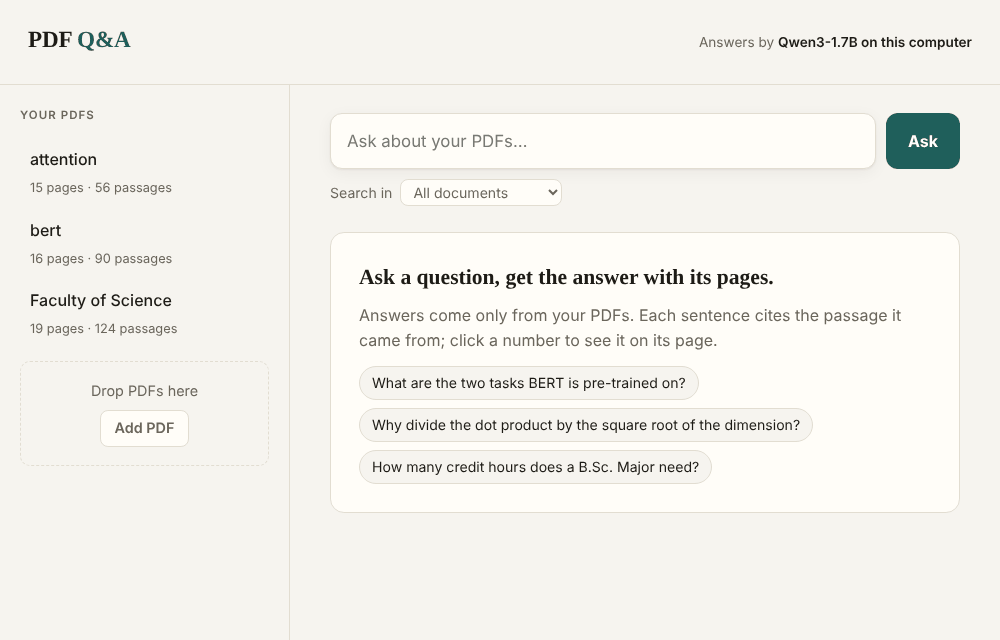
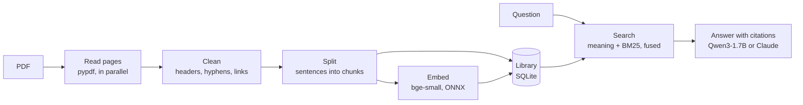
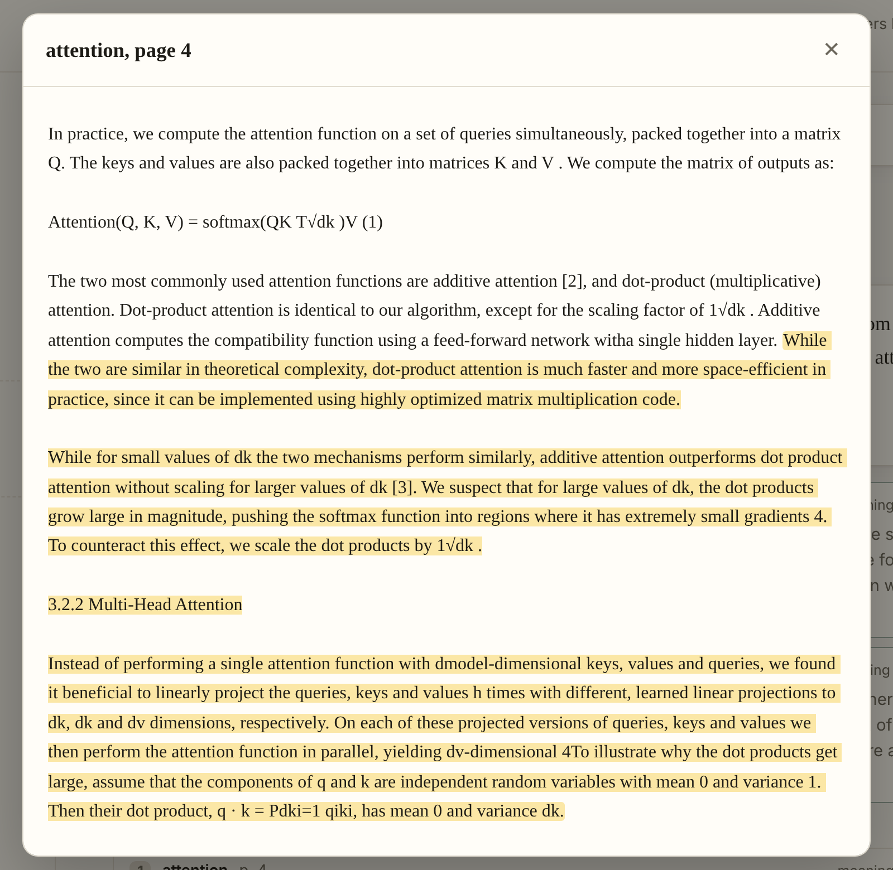

# PDF Q&A

[](https://github.com/omdkpatel810-ops/pdf-qa-rag/actions/workflows/tests.yml)


[](LICENSE)

Ask questions about your PDFs and get answers with page citations, using retrieval-augmented generation (RAG).

> **Status: all 4 milestones are done.** `pdfqa ask` answers a question from your PDFs in a few sentences, citing the page each fact came from, `pdfqa serve` opens a web page for the same, and `pdfqa evaluate` measures how often it's right ([accuracy](#accuracy)).

**At a glance**

- Reads the **1,239-page** University of Manitoba undergraduate calendar into 9,350 chunks in **86 s**. That's half the 162 s a single process takes, because pages are read in parallel, one process per core (this machine has 2).
- Repairs words hyphenated at line ends using the document itself as the dictionary. It is right on **342 of 346** in two well-known papers, and keeps 47 real compounds like *fine-tuned* that the usual "always join" rule mangles into *finetuned*.
- Searches by meaning with **bge-small-en-v1.5**, an open embedding model that runs on your own CPU (no API key, no cost), and by keywords with BM25, then fuses the two. On the 9,350-chunk calendar, a question takes about **30 ms**.
- Writes the answer with **Qwen3-1.7B on your own computer**, through a generation loop written here on ONNX Runtime (no PyTorch, no API key), or with Claude if you have a key. Every citation is checked against the passages the model was given, so none points at nothing.
- On a 30-question test set it answers **22 of 25** answerable questions right with the free local model, and declines **all 5** that the PDFs don't answer instead of making something up. Search puts the passage holding the answer in its top 5 for **24 of 25**. Every answer is [saved](eval/results/qwen3-1.7b.json) and was checked by hand.
- 297 tests with 100% line coverage, plus 7 that run the real models. They include property-based tests (Hypothesis) that check, on 300 random documents per run, that every word lands in a chunk, in order, within the size limit.



*Real answers at 4x speed, from Qwen3-1.7B on a 2-core machine; the first answer includes loading the model. Made with `scripts/make_demo_gif.py`.*

## How it works



1. **Read.** Every page's text, its printed page number (so citations can say "p. iv") and the title from the PDF's metadata. Long PDFs are read by several processes at once.
2. **Clean.** PDFs store lines, not paragraphs, so the text needs repair before it's useful (see [What cleaning fixes](#what-cleaning-fixes)).
3. **Split.** Pages become chunks of up to 200 words built from whole sentences. Each chunk repeats the end of the one before, and records the pages it came from.
4. **Store.** Documents, cleaned pages and chunks go into one SQLite file. Re-splitting with other settings works from the stored pages, without the PDF.
5. **Embed.** Each chunk becomes a vector of 384 numbers that sit close to the vectors of text meaning the same thing. They're stored beside the chunks, with a full-text index for keyword search.
6. **Search.** A question is turned into a vector the same way and compared with every chunk, and also matched word by word. The two rankings are combined (see [Search](#search)).
7. **Answer.** The five best passages go to a language model, numbered and labelled with their pages. It writes a short answer that cites them, and the citations are checked (see [Answers](#answers)).

## Quick start

Requires Python 3.10 or newer.

```bash
git clone https://github.com/omdkpatel810-ops/pdf-qa-rag.git
cd pdf-qa-rag
python3 -m venv .venv
source .venv/bin/activate        # Windows: .venv\Scripts\activate
pip install -e ".[dev]"

python scripts/get_samples.py    # two papers and a UofM calendar section, into samples/
pdfqa add samples/*.pdf
pdfqa search "why divide the dot product by the square root of the dimension"
pdfqa ask "Why divide the dot product by the square root of the dimension?"
pdfqa serve                      # the web page, at http://127.0.0.1:8000
```

```text
Added #1 "attention" (attention.pdf): 15 pages, 56 chunks in 1.9 s.
  Removed 15 header or footer lines.
  Made 56 search vectors in 8.7 s.
Added #2 "bert" (bert.pdf): 16 pages, 90 chunks in 0.8 s.
  Removed 1 header or footer line.
  Made 90 search vectors in 14.4 s.
Added #3 "Faculty of Science" (uofm-science.pdf): 19 pages, 124 chunks in 3.2 s.
  Removed 38 header or footer lines.
  Made 124 search vectors in 17.7 s.
```

The first `add` downloads the embedding model (133 MB), and the first `ask` the answer model (2.1 GB). Both are kept for next time, and after that everything runs offline.

```text
$ pdfqa ask "Why divide the dot product by the square root of the dimension?"
The division by the square root of the dimension, √dk, is done to prevent the dot product from becoming too large, which would make the softmax function unstable [2]. This scaling ensures that the attention weights remain balanced and prevents numerical issues during the computation [3].

Sources
  [2] "attention" p. 4: While the two are similar in theoretical complexity, dot-product attention is much faster and more space-efficient in practice, …
  [3] "attention" p. 4: In practice, we compute the attention function on a set of queries simultaneously, packed together into a matrix …

Qwen3-1.7B on this computer · 61.3 s
```

That time includes loading the model (about 20 s); `pdfqa serve` loads it once.

## Usage

| Command | What it does |
| --- | --- |
| `pdfqa add FILE.pdf [...] [--title T] [--size 200] [--overlap 40]` | Add PDFs. Adding the same file again (even renamed) is noticed. |
| `pdfqa list` | Every document with its pages and chunks |
| `pdfqa show ID [--page N]` | A document's details, or the cleaned text of one page |
| `pdfqa chunks ID [--page N] [--limit 10 \| --all]` | Print chunks with their pages |
| `pdfqa rechunk ID --size N --overlap N` | Split again with other settings, from the stored pages |
| `pdfqa remove ID` | Remove a document and its chunks |
| `pdfqa search QUESTION [-k 5] [--mode hybrid\|semantic\|keyword] [--doc ID] [--full]` | The chunks that best answer a question, with their pages |
| `pdfqa index` | Make search vectors for any chunks without them (say, after adding offline) |
| `pdfqa ask QUESTION [-k 5] [--model local\|claude] [--doc ID]` | An answer with page citations, written from the `-k` best passages |
| `pdfqa serve [--port 8000] [--model ...] [--no-browser]` | The web page: add PDFs, ask, and click a citation to see it on its page |
| `pdfqa evaluate QUESTIONS.json [--search-only] [--model ...] [--json FILE]` | Measure search and answers on a test set ([format](pdfqa/evaluate.py), [example](eval/questions.json)) |

The library lives in `~/.pdfqa/library.db`. Use `--db PATH` or `PDFQA_DB` for another file.

```text
$ pdfqa chunks 2 --limit 1
── chunk 1 · p. 1 · 113 words ──────────────────────────────────────────
BERT: Pre-training of Deep Bidirectional Transformers for

Language Understanding

Jacob Devlin Ming-Wei Chang Kenton Lee Kristina Toutanova Google AI Language {jacobdevlin,…}@google.com

Abstract

We introduce a new language representation model called BERT, which stands for Bidirectional Encoder Representations from Transformers. Unlike recent language representation models (Peters et al., 2018a; Radford et al., 2018), BERT is designed to pre-train deep bidirectional representations …
```

Problems get a plain message rather than a traceback:

```text
error: catalog.pdf isn't a PDF, it's a web page. The download probably went wrong.
error: outline.pdf is password-protected. Remove the password and try again.
error: scan.pdf has no text to read. It's probably scanned images; text recognition (OCR) isn't supported yet.
```

## Search

```text
$ pdfqa search "why divide the dot product by the square root of the dimension" -k 2
── 1 · #1 "attention" p. 4 · meaning #2 · keywords #1 ──────────────────
Figure 2: (left) Scaled Dot-Product Attention. (right) Multi-Head Attention consists of several attention layers running in parallel. of the values, where the weight assigned to each value is computed by a compatibility function of the query with the corresponding key. 3.2.1 Scaled Dot-Product Attention We call our particular attention "Scaled Dot-Product Attention" (Figure 2). The input consists of queries and …

── 2 · #1 "attention" p. 4 · meaning #1 · keywords #2 ──────────────────
While the two are similar in theoretical complexity, dot-product attention is much faster and more space-efficient in practice, since it can be implemented using highly optimized matrix multiplication code. While for small values of dk the two mechanisms perform similarly, additive attention outperforms dot product attention without scaling for larger values of dk [3]. We suspect that for large values …
```

The second chunk goes on to give the paper's answer: for large dimensions, dot products grow large and push the softmax into regions with tiny gradients. Each result says which document and page it's from, and where it ranked in each kind of search.

Three ways to search, with `--mode`:

| Mode | How | Good at |
| --- | --- | --- |
| `semantic` | The question's vector against every chunk's, by cosine similarity | Questions worded differently from the text: "Which course teaches coding?" finds "COMP 1012 teaches programming" |
| `keyword` | BM25 over SQLite's full-text index, matching word endings (*credits* finds *credit*) | Exact terms a model can blur: course codes, names, numbers |
| `hybrid` (default) | Reciprocal rank fusion: each chunk scores 1 / (60 + rank) from each list, added up | Both. A chunk near the top of either list rises, and one on both rises most |

Fusing ranks rather than scores matters because BM25 and cosine scores aren't on the same scale. On the test set, hybrid comes out best, though only just ahead of meaning alone ([accuracy](#accuracy)).

### Speed

Measured on a 2-core machine with `scripts/search_speed.py`. The model and the vectors are loaded once, as a long-running app would, and each figure is the median of 4 questions run 5 times each.

| Library | Chunks | Load model | Load vectors | `hybrid` | `semantic` | `keyword` |
| --- | ---: | ---: | ---: | ---: | ---: | ---: |
| The three samples | 270 | 0.5 s | 2 ms | 13 ms | 11 ms | 1 ms |
| UofM calendar, 1,239 pages | 9,350 | 0.5 s | 30 ms | 30 ms | 15 ms | 15 ms |

Most of a semantic search is the model reading the question (about 10 ms). Comparing it with every chunk is one matrix product over 14 MB of vectors, so exact search is still quick at this size and an approximate index (FAISS, HNSW) isn't worth its complexity yet. The slow part is making the vectors, once per PDF: the calendar's 9,350 took 10 minutes, about 15 a second.

## Answers



How an answer is made ([`answer.py`](pdfqa/answer.py)):

1. Hybrid search picks the five best passages.
2. The model gets the question, the passages numbered [1] to [5] with their document and page, then the question again with the rules: answer in two to four sentences from the sources only, end each sentence with its source's number, write plain text, and if the sources don't answer it, say only "The documents don't say."
3. The reply is tidied. "Source [2]", "[Source 2]", "[2, 3]" and "[2-4]" become [2], [2][3] and [2][3][4]. Numbers with no passage behind them are dropped. A "The documents don't say." tacked onto an answer that does cite something is removed. Maths written as LaTeX, which a small model does even when told not to, becomes plain text the way the PDF writes it: `$\frac{1}{\sqrt{d_k}}$` becomes 1/√dk, while "$5 and $10" stays as it is.
4. Each remaining [n] is a passage, and each passage knows its document and printed page numbers. On the web page the number is a button that opens the passage, highlighted on its page.

When the documents don't say, `pdfqa ask` says so and lists the closest passages, rather than guessing.

### Two models

| `--model` | What writes the answer | Needs |
| --- | --- | --- |
| `local` (default) | Qwen3-1.7B, 4-bit, on your CPU with ONNX Runtime | Nothing: free, offline, and your PDFs never leave the computer |
| `claude`, or a Claude model id | Claude Haiku 4.5 by default, through Anthropic's API | `pip install -e ".[claude]"` and your own API key |

For Claude, create a key at [console.anthropic.com](https://console.anthropic.com), set it in your terminal with `export ANTHROPIC_API_KEY=...` (never in a file you commit), then `pdfqa ask --model claude "..."`. `PDFQA_MODEL=claude` makes it the default.

### The generation loop

ONNX Runtime runs one forward pass of the model. The loop that turns passes into text is in [`generate.py`](pdfqa/generate.py):

- **Prefill in slices, with a KV cache.** The prompt goes through in slices of 256 tokens. Each pass returns the attention keys and values for its tokens, which later passes read instead of recomputing. Slicing keeps memory flat: every pass also returns a score for each of the 151,936 vocabulary entries at every position, so a single pass over a 1,200-token prompt needs 730 MB for those alone. On this 7 GB machine, that ran out of memory.
- **Greedy decoding.** The highest-scoring token wins, so the same question gets the same answer and milestone 4's accuracy test is repeatable.
- **Repetition penalty, except for citations.** Tokens already written score a little lower (÷1.1), the usual guard against greedy loops, but not brackets and digits, so a second [2] isn't discouraged.
- **No thinking.** Qwen3 can reason before answering. An empty thinking block at the start of its reply switches that off; short answers from given passages don't need it, and it would triple the wait.
- **Streaming.** Text appears as it's written. Half of a multi-byte character (an accented letter, a √) is held back until the rest arrives.

### Choosing the local model

While writing the prompt, I tried small open models on the same questions:

| Model | What happened |
| --- | --- |
| Qwen2.5-0.5B | Copied the sources back instead of answering, and repeated the prompt's example sentence word for word |
| Qwen2.5-1.5B | Mostly didn't cite, and said "The documents don't say" to a question the passages answered |
| Qwen3-0.6B | Cited, but answered from the wrong passages (BERT's training data instead of its training tasks) |
| **Qwen3-1.7B** | Cited the right passages, and said so when the documents didn't cover a question |

Then 4-bit against 8-bit Qwen3-1.7B, on five questions: 4-bit got 4 right, 8-bit 3. How they failed mattered more. 4-bit's one miss was a cautious "The documents don't say". 8-bit missed one that way too, but its other miss was a wrong answer: it named two unrelated passages as "the two tasks BERT is pre-trained on". A wrong answer with a citation is worse than no answer, so 4-bit it is.

### Speed

Measured with `scripts/answer_speed.py` on the same 2-core machine, no GPU, with the model already loaded. Loading takes about 20 s: once for `pdfqa serve`, every time for `pdfqa ask`.

| Four questions about the sample PDFs | Median |
| --- | ---: |
| Until the first word appears | 21 s |
| Writing speed | 3.6 tokens a second |
| Whole answer | 20 to 36 s |

Most of the wait is reading: five passages make a prompt of about 1,100 tokens, against 6 to 55 tokens of answer. Fewer passages (`-k 3`) shorten it, and `--model claude` moves the work to Anthropic's servers. This machine is the slow end; I haven't measured a laptop yet.

### The web page

`pdfqa serve` is about 340 lines of Python on the standard library's `http.server`, no web framework, plus one HTML file. Answers and upload progress stream back one JSON object per line. It does one model job at a time, since two at once would only slow each other down. It works in light and dark mode and on a phone.

It listens on 127.0.0.1 only, and two checks keep other websites open in the same browser from using it. Every request must name this server as its Host, which defeats DNS rebinding (a site pointing its own name at 127.0.0.1). Requests that change anything must carry an `X-Pdfqa` header, which another site's page can't add without permission the server never gives.

## Accuracy

`pdfqa evaluate eval/questions.json` runs the [test set](eval/questions.json): 30 questions about the three sample PDFs. Eight are on the Transformer paper, eight on BERT, nine on the UofM Faculty of Science calendar, and five are questions none of them answer (parking, tuition, GPT-3, the year UofM was founded, ResNet-50). Each answerable question says what a right answer must contain and what text marks a passage holding the answer, checked against the PDF. Judging passages by their text rather than their page lets one test set compare chunk sizes.

### Search

Where the first passage holding the answer ranks, for the 25 answerable questions. MRR (mean reciprocal rank) scores first place 1, second 0.5, third 0.33, and so on.

| Mode | Top 1 | Top 3 | Top 5 | MRR |
| --- | ---: | ---: | ---: | ---: |
| **hybrid** (default) | **80%** | 88% | **96%** | **0.86** |
| semantic (meaning) | 76% | 88% | 96% | 0.83 |
| keyword (BM25) | 64% | 84% | 88% | 0.75 |

| Words per chunk, hybrid search | Chunks | Top 1 | Top 3 | Top 5 | MRR |
| --- | ---: | ---: | ---: | ---: | ---: |
| 100 | 442 | 68% | 80% | 92% | 0.76 |
| **200** (default) | 270 | **80%** | 88% | **96%** | **0.86** |
| 300 | 202 | 76% | 92% | 96% | 0.85 |

- **Hybrid wins, narrowly.** It ranks the answer first in 20 of 25, against 19 for meaning alone and 16 for keywords alone. Keywords alone miss 3 of 25 even in their top 5.
- **200 words stays.** 100-word chunks do worse on every measure, probably because an answer gets cut off from the words that would find it. 300 ties at the top 5 but ranks the answer first less often (`scripts/chunk_sizes.py`).
- **The one miss:** "How does the Transformer encode the position of each word?" The sine-and-cosine passage ranks 5th by meaning but 7th after fusion, because keyword search doesn't find it at all.
- **Fusion can cost a place.** For "How many credit hours does a B.Sc. Major need to graduate?", meaning search ranks the "120 credit hours" passage first. Keyword search misses it, and fusion drops it to 5th, just inside what the model reads.

### Answers

Qwen3-1.7B on this computer, reading the five best passages for each question:

| | |
| --- | ---: |
| Right answers | **22 of 25 (88%)** |
| The answer was among the five passages | 24 of 25 |
| Right, and citing a passage that holds the answer | 20 of 22 |
| Citations that point at a passage holding the answer | 24 of 30 (80%) |
| Unanswerable questions declined ("The documents don't say") | **5 of 5** |
| Median time per answer, 2-core machine | 32 s |

Every answer is saved in [`eval/results/qwen3-1.7b.json`](eval/results/qwen3-1.7b.json), and I checked all 30 by hand. The hand check agreed with every automatic right-or-wrong mark. It also caught two evidence patterns that were too narrow: one missed BERT "trained for 1M steps", and the other a GPA written as "at least 3.00". Those made good citations count as bad, so the patterns now accept both wordings, and the figures above come from the re-run. Greedy decoding gave the same 30 answers, word for word.

The three wrong answers:

| Question | It said | Why |
| --- | --- | --- |
| Why are dot products scaled by 1/√dk? | To keep the softmax "numerically stable" when dot products are large | Half right. The paper's reason is that large dot products push the softmax into regions with extremely small gradients. The passage saying so was among the five, but it cited two others. |
| How does the Transformer encode the position of each word? | A description of self-attention | Search miss: the passage on sine and cosine encodings ranked 7th, so the model never saw it. |
| What minimum GPA does a Computer Science Major need? | 2.00 | A misreading: both passages it cited say "2.00 (2.50 for Computer Science)". |

Two right answers had citation trouble. For BERT's pre-training tasks it cited the title page instead of page 2, as described under [Limitations](#limitations). For BERT's training data it wrote "(2,500M words]4", a broken bracket, so the citation was lost. One more right answer was muddled: it gave BERT's 1M training steps correctly, then added the Transformer paper's 300,000 steps and said the total "is not explicitly stated".

**What this says.** Search is the stronger half: the answer was in front of the model 24 times out of 25, and two of the three mistakes happened with it there. A larger model would likely close some of that gap. `pdfqa evaluate eval/questions.json --model claude` runs the same test with Claude for anyone with a key; I haven't run it. Next on the search side is weighting the fusion, so a confident meaning match isn't pulled down by a keyword miss. And 30 questions is a small set: each one is 4 points, so differences of one or two questions between settings are within noise.

## What cleaning fixes

Every fix below came from looking at real PDFs, not from a list of guesses.

| In the PDF | After cleaning | How |
| --- | --- | --- |
| `language representa-` / `tion model` | `language representation model` | Line-end hyphen joined |
| `without substantial task-` / `specific architecture` | `task-specific architecture` | The paper writes *task-specific* elsewhere, so the hyphen stays |
| `(https://catalog.umanitoba.ca/` / `undergraduate-studies/science/` / `mathematics/applied-mathematics-` / `bsc-major-economics-option/)` | one unbroken web address | A line ending inside a link continues it |
| `Faculty of Science  3` and `4  Faculty of Science` atop every page; `%B 12, 2026` (a broken date) at every bottom | removed | Lines at the top or bottom of at least half the pages, ignoring page numbers |
| `2`, `3`, `4` … at the foot of each page | removed | Same rule, so page numbers go too |
| `arXiv:1810.04805v2 [cs.CL] 24 May 2019` in the middle of page 1 | removed | arXiv's sideways stamp, matched exactly |
| `fine-tuned`, no-break spaces, zero-width characters | `fine-tuned`, plain spaces | Character replacements |

**Hyphens are the hard part.** A hyphen at a line end can be a word split for space (*representa-tion*) or part of the word (*task-specific*). Whichever spelling the document uses elsewhere wins. When it uses neither, the hyphen is kept inside a longer compound (*left-to-* + *right*), or between two words the document uses on their own (*sequence-* + *aligned*). Pieces of split words are left out when counting, so *tion* never counts as a word. `scripts/hyphen_report.py` prints every decision for a PDF, so this can be checked by eye. On the BERT and Transformer papers, 4 of 346 are wrong: *right-side*, *multi-granularity*, and *sequence-aligned* twice. Each is a compound that appears only once and whose second half never appears alone.

**Guard rails.** A line is never removed as a header if it's the only text on its page, so a deck of pages that just say "Question 1", "Question 2" keeps them. Pages pypdf can't read, and pages with no text (scans), are kept empty and reported, rather than stopping the whole document.

## How chunks are made

- **Whole sentences**, up to `--size` words (200 by default). The splitter knows that *e.g.*, *Fig.*, *et al.*, *B.Sc.* and initials don't end sentences.
- **Overlap.** Each chunk starts with the last sentences of the previous one, up to `--overlap` words (40 by default). A fact on a boundary then appears whole in at least one chunk.
- **Paragraphs.** Once a chunk is half full, it ends at the next paragraph break rather than mixing two topics. Headings and bullets start new paragraphs.
- **Pages.** Each chunk records its first and last page, which become the answer's citation later.
- **Long "sentences"** (tables and lists without full stops) are cut into overlap-sized pieces, so the size limit and the overlap still hold.

These rules are checked as properties: for any document Hypothesis can invent, every chunk is a contiguous run of the text within the size limit. Consecutive chunks overlap by at most the overlap and never skip a word. The last chunk ends at the last word.

## Tried on real PDFs

| PDF | Pages | Chunks | Time | Headers and footers removed |
| --- | ---: | ---: | ---: | ---: |
| [BERT](https://arxiv.org/abs/1810.04805), two columns | 16 | 90 | 0.7 s | 1 (arXiv stamp) |
| [Attention Is All You Need](https://arxiv.org/abs/1706.03762) | 15 | 56 | 1.3 s | 15 |
| [UofM Faculty of Science calendar](https://catalog.umanitoba.ca/undergraduate-studies/science/) | 19 | 124 | 2.2 s | 38 |
| UofM undergraduate calendar 2023-24 | 1,239 | 9,350 | 86 s | 1,232 |

Measured on a 2-core Linux machine, Python 3.11.

## Design decisions

- **pypdf for reading.** On the sample PDFs it was 1.7x faster than pdfminer.six and kept table rows together ("4 120 Yes"), where pdfminer moved them away from their program names. pypdfium2 was 14x faster still, but split the UofM calendar into one letter per line. PyMuPDF is fast too, but its AGPL licence doesn't fit an MIT project.
- **Parallel pages, not a faster library.** Text extraction was 96% of the time on the full calendar. Spreading pages over processes kept pypdf's quality, halved the time on 2 cores and scales with more. If processes aren't allowed (some sandboxes), it falls back to reading pages one by one.
- **Sizes in words, not tokens.** Tokens depend on the embedding model, so words are the steadier unit. 200 words stayed the default after the test set compared 100, 200 and 300 ([accuracy](#accuracy)).
- **SQLite.** One file, no server, and foreign keys with `ON DELETE CASCADE` keep pages and chunks tied to their document. The schema carries a version number so later milestones can add tables safely.
- **The file's hash identifies a document.** Adding the same PDF twice, even under another name, points to the existing copy instead of storing it again.
- **bge-small-en-v1.5 for embeddings.** It's one of the strongest small models at retrieval, and its 512-token limit fits the chunks: on the sample PDFs a 200-word chunk is 198 tokens at the median and 315 at the 95th percentile. The popular all-MiniLM-L6-v2 stops at 256 tokens, so it would have cut off the end of many chunks. bge-small has 33 million parameters, so it runs on a laptop CPU.
- **ONNX Runtime, not PyTorch.** The same model, run with a much smaller install. The pipeline is the model's own: WordPiece tokens, the encoder, the [CLS] token's vector, scaled to length 1 ([`embed.py`](pdfqa/embed.py)). Its vectors match fastembed's, an independent implementation, to four decimal places, and a test checks that. The model is pinned to one revision, so stored vectors stay comparable.
- **One chunk at a time.** Batching texts usually speeds models up, but a batch is padded to its longest text. On a 2-core machine, one at a time was fastest: 10 chunks a second, against 7 in batches of 32.
- **A small model on your own computer by default.** Questions about your own PDFs often involve things you'd rather not send anywhere, and a default that needs an account and a key is a default most people never get past. Claude is one flag away when speed or quality matters more.
- **Our own generation loop.** ONNX Runtime's `onnxruntime-genai` package does this too, but needs models exported in its own format. A loop of about 40 lines works with the ordinary ONNX exports on Hugging Face, adds no dependency, and its prefill, cache and stopping rules are tested with a stand-in model.
- **Check citations instead of trusting them.** A small model's [7] when there were five passages, or "Source [2]" instead of [2], would otherwise reach the page as a broken link. Tidying turns the model's text into citations that always point at a real passage and page.
- **No web framework.** Six routes don't need one, and the standard library server streams just as well.
- **Exact search, not an approximate index.** Comparing a question with every vector is one matrix product. That takes milliseconds even for the 9,350-chunk calendar, so an approximate index (HNSW and the like) would add complexity for nothing at this size.
- **Clean worker processes.** Pages are read by worker processes that start from a fork server, not by forking pdfqa itself. After the first PDF, the embedding model is running threads, and forking a process with threads can deadlock.

## Limitations

- Scanned PDFs have no text to read; text recognition (OCR) isn't supported.
- Maths comes out garbled (`q · k = Pdki=1 qiki`), as with most PDF text extraction.
- A word hyphenated across a page break stays split, since each page is cleaned on its own.
- Figure labels end up in the text where the PDF puts them.
- A chunk longer than 512 tokens (a dense table, say) is embedded from its first 512 only. That was 4 of the 270 chunks in the samples. Keyword search still sees all of it.
- The model sees only the five best passages. Asked "How many credit hours does a B.Sc. Major need?", it never saw the passage saying 120, so it took the 24 to 30 hours needed to *declare* a Major for the total. That's a wrong answer, with a citation that makes it look right. (Worded "…need to graduate?" in the test set, search ranked the right passage 5th and the answer was right.)
- A citation can point at the wrong passage when the answer is right. Asked BERT's two pre-training tasks, it named them correctly but cited the paper's title page rather than page 2, where they're described. On the test set, 6 of 30 citations pointed at a passage without the answer.
- Qwen3-1.7B can miss a paraphrase. Asked how long it takes "to put a closet together", it said the documents don't say, though a passage covered wardrobe assembly.
- The web page is for one person on their own computer. It isn't built to be put on the internet.

## Tests

```bash
python -m pytest --cov     # 297 tests, 100% coverage; fails under 95%
PDFQA_REAL_MODEL=1 python -m pytest tests/test_model.py   # also the real models (downloads them)
ruff check . && ruff format --check .
```

Test PDFs are generated in the tests with ReportLab, with headers, footers, roman page numbers, passwords, blank "scanned" pages and damaged files, so the suite needs no downloads. A small stand-in embedder (words hashed into 64 numbers) tests storing, indexing and ranking vectors without the real model. The generation loop is tested with a pretend model that predicts "the next number" and checks the attention cache on every pass, and answers with a scripted writer. The web server's tests run it for real on a free port, uploads included. The real models have their own tests: the embedder must match fastembed's vectors and find the right passage for questions that share no words with it, and Qwen3 must cite the passage that answers a question and say so when none does. The evaluation code is tested on a small library with the same stand-ins, from loading a test set to the final report. GitHub Actions runs the suite on Python 3.10 and 3.13, and the real models' tests, on every push.

## Roadmap

- [x] **Milestone 1:** parse PDFs and split them into chunks
- [x] **Milestone 2:** embeddings and vector search
- [x] **Milestone 3:** answers with page citations in a simple UI
- [x] **Milestone 4:** measure accuracy on a 30-question test set

## License

[MIT](LICENSE) © 2026 Om Patel
